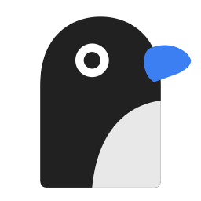
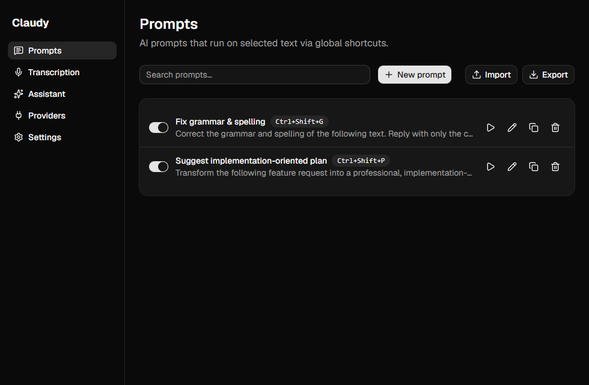
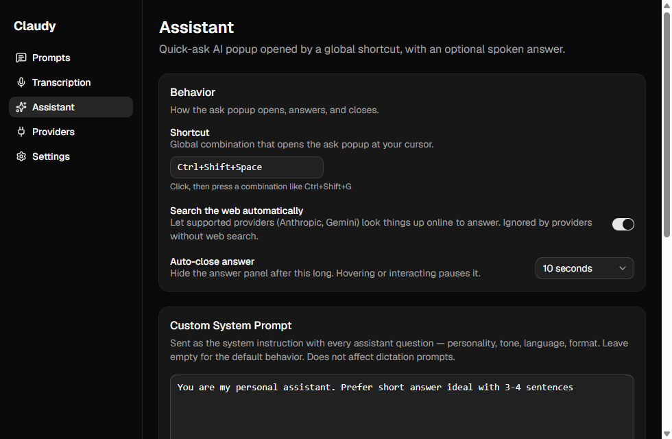
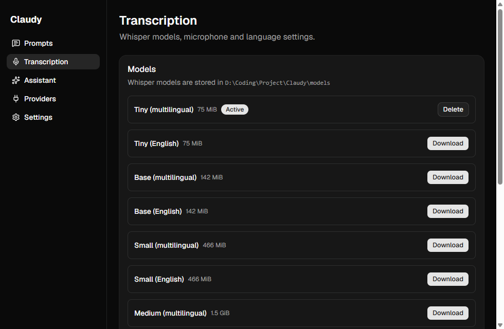
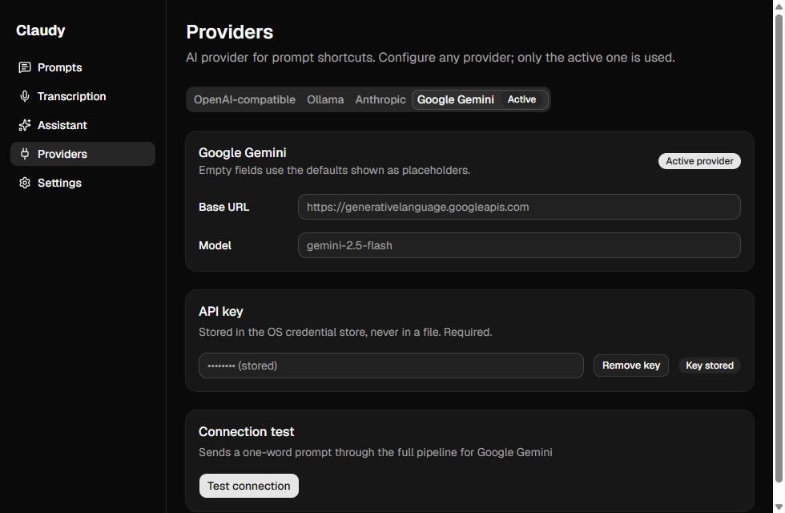

<p align="center">
  
</p>

<h1 align="center">Claudy</h1>

<p align="center"><b>Talk, select, ask — Claudy brings voice typing and AI help to every app on your computer, and keeps your data private.</b></p>

Claudy sits quietly in your system tray. Press a keyboard shortcut in any application and it can:

- **Type what you say** — your speech is turned into text on your own computer and typed into whatever app you're using. Your voice never goes online.
- **Rewrite selected text with AI** — create your own shortcuts like "fix grammar" or "make this shorter". Select text anywhere, press the shortcut, and the result is copied to your clipboard. Your original text is never replaced.
- **Answer your questions** — a small ask box opens right at your cursor. The answer appears in a floating panel and can be read aloud by a natural-sounding voice that runs on your machine.

Built with Tauri 2 and React. Windows-first — macOS and Linux code paths exist but are untested.

## Demo

<p align="center">
  
</p>

## Screenshots

| Prompts | Assistant |
| --- | --- |
|  |  |

| Transcription | Providers |
| --- | --- |
|  |  |

## Features

### Voice dictation
- Hold `Ctrl+Shift+D` (changeable) in any app while you talk, release to drop the text where you're typing; a small on-screen pill shows when you're recording
- Tapped it instead of holding? Recording keeps going until you press again, so nothing is lost. Prefer that every time — switch Activation to "Press to toggle" in Settings
- Everything happens on your computer (whisper.cpp) — audio is kept in memory only, never saved to disk or sent anywhere
- Download speech models inside the app, with progress bars and file checks; remove them anytime
- Choose your microphone and try it out with the built-in test recorder

### Custom vocabulary
- Speech models are good at ordinary English and bad at the words you care about most — colleagues' names, product names, in-house jargon. Tell Claudy how to spell them once and every transcript is corrected before it reaches the app you're typing into
- Add rules on the Transcription page: *when Claudy hears "get hub", write "GitHub"*. A **Try it** box runs your rules on a sample as you type, so you can watch one work before you rely on it
- Rules match whole words only, so a rule for "cat" never touches "category". Capitalisation is worked out for you: a lowercase replacement follows how you said it ("teh" → "the", "Teh" → "The"), while a replacement you spelled yourself is left exactly as written — "GitHub" never comes out as "Github"
- Leave the replacement blank to drop a word entirely — a quick way to strip "um" out of everything you dictate
- Need a rule to be literal? Turn on **Aa** for exact-case matching, for cases like "it" → "IT"
- Longer phrases win over shorter ones, and a correction is never re-corrected by another rule, so rules can't cascade or loop
- Applies to dictation, spoken questions to the assistant, and the mic test. The wake word is still matched on what you actually said, so a rule can never stop "Hey Claudy" working
- Share a rule set as a JSON file with **Import** / **Export**; importing the same file twice updates rules instead of duplicating them

### AI prompt shortcuts
- Create prompts with their own global shortcuts. Templates can include `{{selected_text}}`, `{{clipboard}}`, `{{date}}`, and `{{time}}`
- Works on text you select in any application: press the shortcut, and the finished result lands on your clipboard with a notification (pasting it for you is optional and off by default)
- Manage prompts easily: search, turn on or off, run, delete, and share them as JSON files
- Choose your AI service: **Anthropic**, **OpenAI-compatible** (OpenAI, Groq, and others), **Google Gemini**, or **Ollama** (runs on your machine)
- API keys are kept in your operating system's secure credential store — never written to a config file

### Quick-ask voice assistant
- Press `Ctrl+Shift+Space` (changeable) and an ask box opens at your cursor
- Or just say **"Hey Claudy"** — the ask box opens with the microphone already
  running, so you can ask without touching the keyboard. Off by default; turn it
  on under Assistant → Wake word, where you can also change the phrase, pick a
  small detection model, and loosen or tighten the match
- Answers appear in a floating panel: copy them, ask a follow-up, replay the voice, or let the panel close on its own
- Answers can be spoken aloud by a local voice (Kokoro, ~115 MB download) — works fully offline, with a choice of voices, speed, and volume
- Give the assistant standing instructions with a **custom system prompt** — set its tone, language, or answer style once and it applies to every question
- Services that support it can also search the web to answer (Anthropic, Gemini); others simply skip it
- If the voice model is missing or speech fails, you still get the written answer with a short note

### Reminders
- In the ask box, press `Shift+Tab` to switch to **Remind me** mode, type `follow up on this email in 2 hours`, and press Enter
- A line under the box shows the time Claudy worked out (`Today 16:32`) as you type, so a misread is visible before you save
- Times are understood on your computer — `in 90m`, `at 5pm`, `tomorrow at 9`, `next friday`, `tonight`. Only when none of those fit does Claudy ask your AI service to work out the time
- When it's due, a tray notification pops up with exactly what you typed
- Anything that came due while Claudy was closed notifies as soon as you start it, marked overdue
- The **Reminders** page lists everything: snooze, mark done, edit the time, or add one by hand

### Usage stats
- A **Usage** page shows how many prompts you ran per day, which ones you use most, how many tokens went in and out, and roughly what it cost
- Cost comes from a built-in price list per model, and every price is editable — so a provider's change, or a model Claudy hasn't heard of, is a one-line fix. Models running on your own machine (Ollama) count as free, and a model with no price shows its tokens rather than a made-up figure
- The log lives on your computer and holds **facts about runs only** — the time, the prompt's name, which service and model, token counts, and whether it worked. Never your prompts, the text you selected, or the answers
- On by default, kept for 90 days. Turn it off or delete everything under Settings → Usage stats

### App
- Lives in the system tray; closing the window hides the app instead of quitting it
- Turn on **Start with Windows** in Settings and Claudy is there when you sign in — straight into the tray, no window in your face, shortcuts working from the moment you log in
- Settings for shortcuts (with a recorder and conflict warnings), light/dark theme, starting with Windows, and auto-paste
- You always get a notification telling you what happened — nothing fails silently

> **A note on the `Fn` key:** `Fn` can't be part of a shortcut. Windows has no
> `Fn` modifier, and on nearly every keyboard `Fn` is handled inside the keyboard's
> own firmware, so the OS never sees it. The recorder binds what your keyboard
> actually sends. On a programmable keyboard (QMK/VIA or a vendor tool), map the
> Fn-layer key to one of `F13`–`F24` and record that — those bind on their own, no
> other modifier needed.

## Getting started

### Prerequisites (Windows)

- Node.js ≥ 20
- Rust (MSVC toolchain) ≥ 1.77
- Visual Studio Build Tools 2022 with the Desktop C++ workload
- CMake and LLVM (required by whisper-rs) — set `LIBCLANG_PATH=C:\Program Files\LLVM\bin`

See [docs/BUILDING.md](docs/BUILDING.md) for full setup details, macOS/Linux prerequisites, and platform limitations.

### Development

```sh
npm install
npm run tauri dev
```

### Release build

```sh
npm run tauri build
```

Produces a per-user NSIS installer (no admin prompt) at `src-tauri/target/release/bundle/nsis/Claudy_<version>_x64-setup.exe`. The installer is unsigned, so Windows SmartScreen will warn on first run.

After installing, download a Whisper model from the Transcription page before using dictation. Models are stored locally in the project `models/` directory.

## Tech stack

- **Frontend:** React 19, TypeScript, Vite 7, Tailwind CSS v4, shadcn/ui + Radix UI, Zustand
- **Shell:** Tauri 2 (global-shortcut, clipboard-manager, notification, autostart, store, single-instance plugins)
- **Rust core:** whisper-rs (STT), kokoro-tts + ort/ONNX Runtime (local TTS), cpal (audio capture) + rodio (playback), enigo (input simulation), keyring (secrets), reqwest + tokio (AI providers)

## Project layout

```
src/                React UI (pages, components, Tauri API bridges in src/lib)
src-tauri/src/      Rust core: audio, stt, models, shortcuts, selection,
                    inject, prompts, prompt_flow, reminders, tray, overlay,
                    assistant, ai/ providers, tts/ (kokoro engine + playback)
branding/           Logo assets
docs/BUILDING.md    Platform build instructions
docs/screenshots/   README screenshots
models/             Locally downloaded Whisper models (gitignored)
```

## Privacy

- Zero telemetry — nothing is reported to us or to anyone else, ever
- The Usage page is the one thing Claudy writes down about you, and it stays on
  your computer. It records metadata per run: time, prompt name, service, model,
  token counts, duration, and success or failure. It never records your prompts,
  the text you select, the answers, or provider error messages. Switch it off or
  erase it under Settings → Usage stats
- Dictation audio is processed in-memory and never leaves your machine
- The wake word is off until you turn it on. While it listens, it keeps only the
  last couple of seconds of audio in memory, recognises them on your machine, and
  throws them away — nothing is written to disk or sent anywhere. A blue tray dot
  shows whenever it is listening
- API keys live only in the OS credential store
- Selected text is sent only to the AI provider you configured, only when you trigger a prompt

## Documentation

- [Building & platform notes](docs/BUILDING.md)

## Acknowledgements

Claudy is inspired by [Handy](https://github.com/cjpais/Handy), the open-source offline speech-to-text app.

## License

[MIT](LICENSE)
